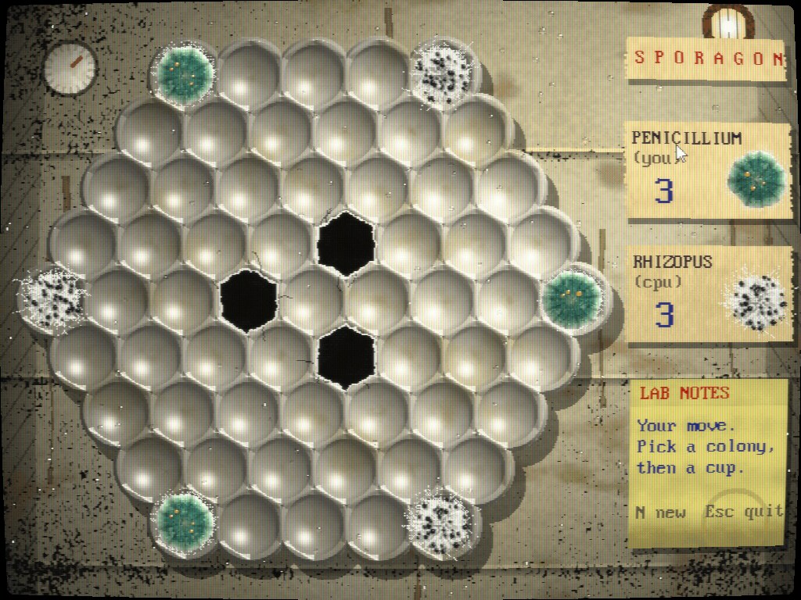

# SPORAGON

A Hexxagon-style board game in the back of a forgotten fridge. Your Penicillium fights the
computer's Rhizopus for a cracked egg tray, in 640x480 with 256 colors on an emulated VESA SVGA
card ([game-toolkit-dosvideo](https://github.com/sunsided/game-toolkit-dosvideo)).



## Playing

```sh
task run        # or: cargo run --release
```

Click one of your colonies, then an empty cup:

- a cup **next to it**: the colony spreads and you keep the original.
- a cup **two away**: the colony jumps there and leaves its old cup.

Either way, every Rhizopus colony touching the target cup is overgrown and turns into yours.
If a side cannot move, the other side grows over every empty cup. The side with more colonies
when the tray is full wins.

| Key | |
|-----|---|
| Mouse | select and move |
| `N` | new game |
| `Esc` | quit |
| `Alt+C` | cycle the CRT filter |
| `Alt+Enter` | fullscreen |

## How it's made

All graphics are generated at startup, no image files. Everything is painted in true color
(fridge wall, egg tray, ten growth stages of four variants per mould), then reduced to one
256-color palette by median cut and dithered with a 4x4 Bayer matrix, the way scanned art was
prepared for VGA. Some details:

- **Penicillium**: velvety blue-green zones, radial furrows, dusty spore bloom, a white fuzzy
  margin of young hyphae, and amber guttation droplets on mature colonies.
- **Rhizopus**: a tangle of white cottony hyphae with sporangia that ripen from white to black.
- **Fridge**: a dimpled egg tray lit by the bulb, condensation drops, brown drips, black
  mildew in the corners, and a bulb that flickers through the palette now and then.

The frame is composed in system memory and copied to the linear framebuffer each vertical
retrace. Moves and takeovers play PC-speaker sweeps. The computer searches three moves deep
with alpha-beta pruning.

## Development

```sh
task test       # rules, AI self-play, layout
task check      # fmt, clippy, tests
task screenshot # refresh docs/screenshot.jpg (needs a display)
```

## License

EUPL-1.2
